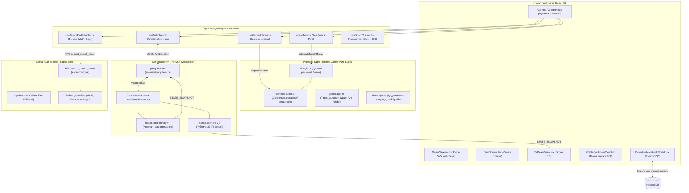
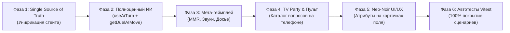

# Архитектурная карта проекта и аудит режима «Очная ставка» (LINE_UP)

> **Статус:** Аналитический отчет и дорожная карта редизайна  
> **Версия:** 1.0 (Ноябрь 2026)  
> **Автор аудита:** Субагент 4 (Архитектурная карта и аудит режима «Очная ставка»)  
> **Стек:** React 18, TypeScript 5, Tailwind CSS, Vite, PartyKit WebSocket, Supabase (PostgreSQL 15, RLS, RPC), IndexedDB, Capacitor 8  

---

## 1. Актуальная архитектурная карта проекта

Проект **«Под подозрением (Prime Suspect)»** представляет собой детективно-стратегическую киберпанк/нео-нуар игру, объединяющую Web (десктоп и мобильные браузеры), PWA, нативные Android-сборки (Capacitor) и телевизионный формат **TV Party** (салонная игра по модели Jackbox с большим экраном и смартфонами-пультами).

### 1.1. Модульная структура репозитория

```
c:\Projects\detective-game\
├── docs/                        # Архитектурная и продуктовая документация
│   ├── ARCHITECTURE.md          # Техническая архитектура
│   ├── GAME_MODES.md            # Спецификация 4 режимов игры и TV Party
│   ├── GAME_RULES.md            # Детальные правила и условия победы
│   ├── DECISIONS.md             # Журнал архитектурных решений (ADR)
│   └── TECHNICAL_DEBT.md        # Реестр технического долга
├── src/
│   ├── assets/                  # Портреты персонажей (c1..c50.webp), текстуры
│   ├── components/              # Визуальные компоненты интерфейса
│   │   ├── auth/                # Модальные окна авторизации и профиля
│   │   ├── board/               # Ячейки доски, сетка, оверлеи сдвигов
│   │   ├── character/           # Карточки персонажей, бейджи, статусы
│   │   ├── controller/          # Мобильный пульт управления TV Party
│   │   ├── dev/                 # Панель разработчика (DevPanel)
│   │   ├── duel/                # Экраны и модальные окна режима «Очная ставка»
│   │   ├── game/                # Панели действий, статусбар, футтеры
│   │   ├── gameOver/            # Финальные модалки победы/поражения
│   │   ├── lobby/               # Лобби, карточки режимов, терминал сети
│   │   ├── profile/             # Экран досье агента, история матчей
│   │   ├── roleReveal/          # Интро-фаза, показ тайных ролей
│   │   ├── rules/               # Справочник правил
│   │   ├── tables/              # Радар игровых комнат, Морзе-фильтры
│   │   ├── tutorial/            # Интерактивное обучение
│   │   ├── tv/                  # Экраны ТВ (TvBoardView, TvLobbyView)
│   │   └── ui/                  # UI Kit (Button, Modal, Card, Badge)
│   ├── constants/               # Игровые константы (персонажи, правила, вопросы)
│   │   ├── duelCharacters.ts    # 25 фигурантов с дискретными атрибутами
│   │   ├── duelQuestions.ts     # 16 вопросов каталога допроса
│   │   └── gameRules.ts         # Лимиты, таймеры, константы режимов
│   ├── contexts/                # React-контексты (Auth, I18n)
│   ├── hooks/                   # Пользовательские хуки состояния и логики
│   │   ├── useAiTurn.ts         # Логика и искусственная пауза бота
│   │   ├── useBoardVisuals.ts   # Расчет подсветки 3×3, радаров, целей
│   │   ├── useDetectiveNotebook.ts # Оффлайн-блокнот игрока (IndexedDB)
│   │   ├── useGameActions.ts    # Диспетчеризация действий матча
│   │   ├── useGameTimer.ts      # Таймер хода и матча
│   │   ├── useMatchEndHandler.ts# Обработка победы, звуков, рейтинга MMR
│   │   └── useProfile.ts        # Синхронизация профиля с Supabase
│   ├── lib/
│   │   └── supabase.ts          # Клиент Supabase с Offline-First mock
│   ├── server/                  # Авторитетный WebSocket-сервер (PartyKit / Node)
│   │   ├── index.ts             # GameRoomServer: валидация, маскирование, тики
│   │   ├── lobby.ts             # Реестр открытых столов
│   │   └── matchmaker.ts        # Автоподбор оппонентов
│   ├── types/                   # TypeScript-интерфейсы
│   │   ├── database.ts          # Схема БД Supabase
│   │   ├── duel.ts              # Типы дедуктивной дуэли
│   │   └── game.ts              # GameState, Character, Role, Action
│   └── utils/                   # Чистые функции ядра и сетевой транспорт
│       ├── aiLogic.ts           # Эвристические алгоритмы ботов для 4 режимов
│       ├── audio.ts             # SoundManager (оригинальные звуки public/sounds)
│       ├── duelLogic.ts         # Фильтрация кандидатов, тай-брейки дуэли
│       ├── gameLogic.ts         # Генерация поля 5×5, тороидальные сдвиги, Anti-Undo
│       ├── gameReducer.ts       # Детерминированный редьюсер GameState
│       ├── partyPeer.ts         # Синглтон PartyService (клиент PartyKit)
│       ├── storage.ts           # IndexedDB и LocalStorage абстракция
│       └── useMultiplayer.ts    # Синхронизация стейта онлайн-матчей
```

---

### 1.2. Архитектурная схема и поток данных (Data Flow)

Ниже представлена актуальная диаграмма потоков данных в системе:



---

### 1.3. Сетевое взаимодействие и протоколы синхронизации

Сетевая подсистема базируется на PartyKit (`PartyServer`) в [src/server/index.ts](file:///c:/Projects/detective-game/src/server/index.ts):

1. **Типы подключений и роли (`ClientType`):**
   - `HOST` / `GUEST` — полноценные игроки со скрытыми ролями и приватными картами.
   - `TV_DISPLAY` — коллективный экран вечеринки. Не имеет тайной роли, получает замаскированный снимок поля без секретных ID.
   - `CONTROLLER` — смартфон участника TV Party. Получает замаскированное состояние со своей персональной ролью.
   - `SPECTATOR` — зритель без права отправки ходов.

2. **Защита данных и античит-маскирование:**
   - **`maskStateForPlayer(state, role, isHost)`** ([src/server/index.ts#L1666](file:///c:/Projects/detective-game/src/server/index.ts#L1666)):
     - Роль `KILLER` не получает `detectiveSecretId`, `detectiveHand`, `inspectorChoices`.
     - Роль `DETECTIVE` не получает `killerSecretId`, `killerHand`, `disguisedNotification`.
     - В режиме `SECRET_SERVICE` все агенты, кроме собственного, получают `secretId: null`.
     - Колода улик `evidenceDeck` обнуляется для всех игроков.
   - **`maskStateForTv(state)`** ([src/server/index.ts#L1636](file:///c:/Projects/detective-game/src/server/index.ts#L1636)):
     - Все тайные ID (`killerSecretId`, `detectiveSecretId`, `duelSecretKillerId`, `duelSecretDetectiveId`, `spies.secretId`) принудительно заменяются на `null`.

3. **Валидация действий на сервере (`validateActionLogic`):**
   - Сервер жестко проверяет очередность хода (`player.role === currentTurn`).
   - Валидирует маневры поля `SHIFT_BOARD` по правилу **Anti-Undo** (запрет зеркального отката предыдущего сдвига).
   - Проверяет живость и статус цели (`isAlive`, `isRobbed`).

4. **Интеграция с Supabase (Offline-First):**
   - Реализована через модуль [src/lib/supabase.ts](file:///c:/Projects/detective-game/src/lib/supabase.ts).
   - При отсутствии облачных ключей или обрыве сети активируется mock-клиент с симуляцией RLS, позволяющий бесшовно играть локально.
   - Защита профиля: прямое изменение полей `mmr`, `cash`, `wins` запрещено триггером `protect_profile_stats`; начисление производится строго через RPC `record_match_result` ([src/hooks/useProfile.ts#L110](file:///c:/Projects/detective-game/src/hooks/useProfile.ts#L110)).

---

### 1.4. Сравнительная матрица всех 4 игровых режимов

| Параметр | 1. Маньяк против Оперативника (`MANIAC_VS_OPERATIVE`) | 2. Охота на Грабителя (`THIEF_HUNT`) | 3. Секретная служба (`SECRET_SERVICE`) | 4. Очная ставка (`LINE_UP` / Дуэль) |
| :--- | :--- | :--- | :--- | :--- |
| **Количество игроков** | 2 игрока (или 1 против ИИ) | 2 игрока (или 1 против ИИ) | 2–9 игроков (FFA или команды) | 2 игрока (или 1 против ИИ) |
| **Размер поля** | 5×5 (25 карт) | 5×5 (25 карт) | 5×5 (2–4 игр.), 6×6 (5–7 игр.), 7×7 (8–9 игр.) | 5×5 (25 карт с дискретными признаками) |
| **Роли игроков** | Оперативник (DETECTIVE) vs Маньяк (KILLER) | Шериф/Полиция (DETECTIVE) vs Грабитель (KILLER) | Тайные агенты разведок (Агент 1 .. N) | Следователь (DETECTIVE) vs Подозреваемый (KILLER) |
| **Тороидальный маневр поля** | **Да** (сдвиг рядов/колонок с Anti-Undo) | **Да** (сдвиг рядов/колонок с Anti-Undo) | **Да** (сдвиг рядов/колонок с Anti-Undo) | **Отключен** (статичная очная ставка) |
| **Пространственная механика 3×3** | **Да** (действия строго в радиусе 3×3 вокруг роли) | **Да** (кража и арест строго в радиусе 3×3) | **Да** (опрос и ликвидация в радиусе 3×3) | **Нет** (дедуктивный опрос по атрибутам) |
| **Уникальные действия роли 1** | Проверка алиби (`EXONERATE`), Задержание (`ACCUSE`) | Вызов патруля (`SWEAR_IN_OFFICER`), Задержание (`ACCUSE`) | Опрос свидетелей (`INTERROGATE`), Ликвидация (`CAPTURE_SPY`) | Задать вопрос (`DUEL_ASK_QUESTION`), Выдвинуть обвинение (`DUEL_ACCUSE`) |
| **Уникальные действия роли 2** | Ликвидация (`KILL_CHARACTER`), Зачистка (`CLEANUP`), Побег (`ESCAPE_MANIAC`) | Кража трофея (`ROB_NEIGHBOR`), Конспирация (`FAST_DISGUISE`) | Опрос свидетелей (`INTERROGATE`), Ликвидация (`CAPTURE_SPY`) | Задать вопрос (`DUEL_ASK_QUESTION`), Выдвинуть обвинение (`DUEL_ACCUSE`) |
| **Условия победы Преступника** | Устранить 4 жертвы (`victimList`) или ликвидировать Оперативника | Украсть 10 монет/трофеев у соседей | Набрать целевое число трофеев (3–4) | Вычислить личность Следователя или вынудить его истратить 3 обвинения |
| **Условия победы Детектива** | Задержать Маньяка (`ACCUSE`) до гибели 4 жертв | Арестовать Грабителя с поличным | Раскрыть тайных агентов соперников | Вычислить личность Подозреваемого методом исключения |
| **Специфика GameState** | `victimList: string[]`, `killCount: number`, `detectiveHand: string[]` | `trophiesKiller: number`, `uniformedOfficers: string[]` | `spies: SpyPlayer[]`, `activeSpyIndex: number`, `interrogationRadar` | `duelHistory: []`, `duelPenalties: {}`, `accusedTargets: {}`, `duelAccusations: []` |
| **Поддержка TV Party** | **Полная** (D-Pad, live-подсветка линий, шторка) | **Полная** (вызов патрулей, кражи, маневр) | **Полная** (до 9 пультов, радар всех агентов) | **Частичная / Требует редизайна** (см. аудит) |

---

## 2. Глубокий аудит режима «Очная ставка» (`LINE_UP`)

Режим **«Очная ставка»** задуман как напряженная логическая дуэль умов в традициях «Guess Who?» / «Клуэдо», где детектив и преступник допрашивают друг друга по чертам внешности, одежде и аксессуарам, методично сужая круг подозреваемых.

### 2.1. Текущая программная реализация

1. **Колода дуэли ([src/constants/duelCharacters.ts](file:///c:/Projects/detective-game/src/constants/duelCharacters.ts)):**  
   Ровно 25 уникальных персонажей (12 женщин, 13 мужчин) с дискретным набором из 9 атрибутов:
   - `gender`: `MALE` | `FEMALE`
   - `hair`: `BALD` | `SHORT` | `LONG_CURLY` | `UPDO`
   - `hasBeard`: `boolean`
   - `outerwear`: `COAT` | `SUIT` | `VEST` | `DRESS`
   - `neckwear`: `TIE` | `BOWTIE` | `SCARF` | `NONE`
   - `hasHat`: `boolean`, `hatType`: `FEDORA` | `CAP` | `BOWLER` | `TOP_HAT` | `BERET` | `KERCHIEF` | `TURBAN` | `NONE`
   - `hasGlasses`: `boolean`
   - `heldItem`: `CARDS` | `CIGARETTE` | `MAGNIFIER` | `NONE`

2. **Каталог вопросов ([src/constants/duelQuestions.ts](file:///c:/Projects/detective-game/src/constants/duelQuestions.ts)):**  
   16 вопросов в 3 категориях:
   - *Внешность:* `q_gender_female`, `q_gender_male`, `q_beard`, `q_bald`, `q_hair_long`, `q_hair_updo`
   - *Одежда:* `q_coat`, `q_suit`, `q_vest`, `q_tie`, `q_bowtie`, `q_scarf`
   - *Аксессуары:* `q_hat_any`, `q_hat_cap`, `q_glasses`, `q_held_item`

3. **Архитектурный рендеринг экрана:**
   - В [src/App.tsx#L988-L997](file:///c:/Projects/detective-game/src/App.tsx#L988-L997) при `mode === 'LINE_UP'` рендерится изолированный компонент [src/components/duel/DuelScreen.tsx](file:///c:/Projects/detective-game/src/components/duel/DuelScreen.tsx).
   - Внутри `DuelScreen` размещена доска `GameBoard`, модальные окна `DuelQuestionCatalogModal`, `DuelCandidatesSheet` и `DuelAccuseModal`.

---

### 2.2. Выявление критических проблем и дефектов архитектуры

В ходе глубокого статического анализа кода выявлены **7 фундаментальных проблем**, блокирующих полноценную работу режима:

#### Дефект 1: «Двоевластие» стейта (State Split-Brain) в оффлайн-режиме
- **Файл:** [src/components/duel/DuelScreen.tsx#L64-L110](file:///c:/Projects/detective-game/src/components/duel/DuelScreen.tsx#L64-L110)
- **Суть проблемы:**  
  В `DuelScreen` объявлен собственный локальный хук `useReducer(duelReducer, undefined, createInitialDuelState)`.
  Если игра запущена локально против бота (`gameState.opponent === "AI"`) или вдвоем на одном экране (`"PVP"`), условие `isOnline` ложно:
  ```ts
  const dispatch = (action: any) => {
    if (isOnline && onDispatchAction) {
      // сетевые экшены
    } else {
      localDispatch(action); // <--- Экшен уходит ТОЛЬКО в локальный редьюсер!
    }
  };
  ```
- **Последствия:** Глобальный стейт `gameState` в `App.tsx` вообще не обновляется! Диспетчер `onDispatchAction` не вызывается. Игра идет в «песочнице» компонента `DuelScreen`, полностью оторванной от корневого приложения.

#### Дефект 2: Полная неработоспособность ИИ-бота (AI Freeze) в одиночной игре
- **Файлы:** [src/components/duel/DuelScreen.tsx](file:///c:/Projects/detective-game/src/components/duel/DuelScreen.tsx), [src/hooks/useAiTurn.ts#L46-L60](file:///c:/Projects/detective-game/src/hooks/useAiTurn.ts#L46-L60)
- **Суть проблемы:**  
  В `aiLogic.ts` написана функция хода бота `getDuelAIMove()`, и хук `useAiTurn.ts` готов её вызывать. Но `useAiTurn` отслеживает состояние `gameState` из `App.tsx`.
  Поскольку `DuelScreen` в оффлайне пишет в свой закрытый `localState`, глобальный `gameState` не знает, что игрок сделал ход! Ход в глобальном стейте зависает на `'DETECTIVE'`.
  В самом `DuelScreen.tsx` нет **ни строчки кода** для вызова `getDuelAIMove` из `localState`!
- **Последствия:** При выборе игры с ботом в режиме «Очная ставка» после первого вопроса игрока бот **никогда не отвечает**. Очередь переходит к `'KILLER'`, таймер тикает 25 секунд, срабатывает `TIMEOUT_PASS`, и ход возвращается игроку. Игра с ботом не работает.

#### Дефект 3: Потеря начисления рейтинга MMR и статистики профиля
- **Файл:** [src/hooks/useMatchEndHandler.ts#L35-L42](file:///c:/Projects/detective-game/src/hooks/useMatchEndHandler.ts#L35-L42)
- **Суть проблемы:**  
  Хук `useMatchEndHandler` слушает `gameState.winner`. При победе в `localState` (внутри `DuelScreen`) значение `gameState.winner` в `App.tsx` остается `null`.
- **Последствия:** Победы и поражения в режиме «Очная ставка» не записываются в Supabase, не начисляют +25/-20 MMR, не обновляют счетчик побед в профиле и не вызывают тактильный отклик и звуки `soundManager.play('win')`.

#### Дефект 4: Критический баг мобильного пульта TV Party (Hardcoded `q_gender`)
- **Файл:** [src/components/controller/MobileControllerView.tsx#L532-L534](file:///c:/Projects/detective-game/src/components/controller/MobileControllerView.tsx#L532-L534)
- **Суть проблемы:**  
  На мобильном пульте при нажатии кнопки «ВОПРОС» отправляется жестко закодированный экшен:
  ```ts
  if (act.id === 'DUEL_ASK_QUESTION') {
    onDispatchAction({ type: 'DUEL_ASK_QUESTION', payload: { questionId: 'q_gender' } });
    return;
  }
  ```
  Однако в `DUEL_QUESTIONS` идентификатора `'q_gender'` **не существует**! Есть только `q_gender_female` и `q_gender_male`.
- **Последствия:** В режиме TV Party при нажатии на кнопку вопроса сервер или редьюсер ищет вопрос по id `'q_gender'`, получает `undefined` и отклоняет действие. Игрок на телефоне физически не может задать вопрос, и у него нет каталога для выбора других вопросов.

#### Дефект 5: Сломанная модель таргетинга обвинения на контроллере TV Party
- **Файл:** [src/components/controller/MobileControllerView.tsx#L550-L567](file:///c:/Projects/detective-game/src/components/controller/MobileControllerView.tsx#L550-L567)
- **Суть проблемы:**  
  Мобильный пульт рассчитывает цели для обвинения строго по массиву `neighbors` (клетки 3×3 вокруг секретного персонажа игрока):
  ```ts
  const targetId = selectedTargetId || neighbors[0]?.id || '';
  ```
  Но в режиме «Очная ставка» соперник может находиться в абсолютно любой клетке поля 5×5! Более того, карточка «ВЫ» не имеет соседей по геймплею, так как пространственная близость в дуэли отключена.
- **Последствия:** Игрок на смартфоне может обвинить только случайного соседа из своей мини-карты 3×3, но не может выбрать реального подозреваемого с экрана ТВ.

#### Дефект 6: Рассинхронизация сетевых таймеров
- **Файл:** [src/components/duel/DuelScreen.tsx#L81-L82](file:///c:/Projects/detective-game/src/components/duel/DuelScreen.tsx#L81-L82), [src/server/index.ts](file:///c:/Projects/detective-game/src/server/index.ts)
- **Суть проблемы:**  
  Даже в онлайне `DuelScreen` забирает таймеры из локального стейта:
  `turnTimeRemaining: localState.turnTimeRemaining, matchTimeRemaining: localState.matchTimeRemaining`.
  Экшен `TICK_TIMER` тикает в независимом `setInterval` на каждом клиенте отдельно, не синхронизируясь с сервером.
- **Последствия:** У двух игроков на экранах отображается разное оставшееся время хода и матча при малейшем сетевом джиттере.

#### Дефект 7: UX/UI-слепота игрока на игровом поле 5×5
- **Файл:** [src/components/GameBoard.tsx](file:///c:/Projects/detective-game/src/components/GameBoard.tsx), [src/components/duel/DuelScreen.tsx#L296-L318](file:///c:/Projects/detective-game/src/components/duel/DuelScreen.tsx#L296-L318)
- **Суть проблемы:**  
  На поле 5×5 карточки персонажей выводятся стандартным компонентом `CharacterCard`, где видны только фото и имя. На них **нет иконок признаков** (очки, шляпа, борода, одежда).
  Чтобы понять, подходит ли персонаж под ответы, игрок вынужден постоянно закрывать и открывать модальный шит «Досье» (`DuelCandidatesSheet`).
  Кроме того, исключенные кандидаты не тускнеют и не помечаются на самом поле 5×5 (за исключением уже обвиненных).

---

## 3. Пошаговый технический план полного редизайна режима «Очная ставка»

Ниже представлен детальный план исправления и глубокого редизайна режима для превращения его в флагманский дуэльный режим проекта.



---

### Фаза 1: Унификация архитектуры и стейта (Single Source of Truth)

**Цель:** Полностью устранить дублирование стейта. Корневой `gameState` и `gameReducer` становятся единственным источником истины.

1. **Отказ от локального `useReducer` в `DuelScreen`:**
   - Преобразовать [src/components/duel/DuelScreen.tsx](file:///c:/Projects/detective-game/src/components/duel/DuelScreen.tsx) в полностью контролируемый (controlled) компонент.
   - Удалить `localState` и `localDispatch`.
   - Все экшены (`DUEL_ASK_QUESTION`, `DUEL_ACCUSE`, `DUEL_TIMEOUT_PASS`, `RESTART_DUEL`, `RESOLVE_DUEL_TIE_BREAK`) диспетчеризировать напрямую через `onDispatchAction`.
2. **Обогащение `GameState` в [src/types/game.ts](file:///c:/Projects/detective-game/src/types/game.ts):**
   - Добавить в `GameState`:
     ```ts
     duelTurnTimeRemaining?: number;   // 25 сек
     duelMatchTimeRemaining?: number;  // 480 сек (8 мин)
     ```
3. **Инициализация в `createInitialState` ([src/utils/gameLogic.ts](file:///c:/Projects/detective-game/src/utils/gameLogic.ts)):**
   - Корректно случайным образом выбирать `killerSecretId` и `detectiveSecretId` из перемешанного пула `DUEL_CHARACTERS` (25 карт), гарантируя, что `killerSecretId !== detectiveSecretId`.
   - Инициализировать `duelTurnTimeRemaining: 25`, `duelMatchTimeRemaining: 480`, `maxAccusations: 3`.

---

### Фаза 2: Восстановление работы ИИ в одиночном режиме

**Цель:** Обеспечить живую, непредсказуемую игру против компьютерного оппонента с дедуктивной логикой.

1. **Интеграция с [src/hooks/useAiTurn.ts](file:///c:/Projects/detective-game/src/hooks/useAiTurn.ts):**
   - Убедиться, что при `gameState.mode === 'LINE_UP'` и `gameState.currentTurn !== gameState.playerRole` взводится флаг `isAIThinking`.
   - По истечении задержки (1800–2200 мс) вызывается `calculateNextAIMove(prev)`, который выполняет `getDuelAIMove(state)` и обновляет глобальный `gameState`.
2. **Оптимизация дедуктивной эвристики бота в [src/utils/aiLogic.ts](file:///c:/Projects/detective-game/src/utils/aiLogic.ts):**
   - **Информационная энтропия:** Бот должен выбирать вопрос, делящий оставшийся пул кандидатов максимально близко к пропорции 50/50 (максимизация полученной информации).
   - **Фаза разоблачения:** Если среди кандидатов осталось 1–2 персонажа, бот с вероятностью 85% переходит к действию `DUEL_ACCUSE`.

---

### Фаза 3: Интеграция мета-геймплея, профиля и аудиосистемы

**Цель:** Завершение партии должно полноценно вознаграждать игрока и сопровождаться качественным аудиорядом.

1. **Связка с `useMatchEndHandler` ([src/hooks/useMatchEndHandler.ts](file:///c:/Projects/detective-game/src/hooks/useMatchEndHandler.ts)):**
   - Поскольку `gameState.winner` теперь выставляется в глобальном стейте, `useMatchEndHandler` автоматически фиксирует победу.
   - Начисление рейтинга MMR (+25 за победу, -20 за поражение) через RPC `record_match_result`.
   - Запись результата матча в историю `matches` профиля.
2. **Аудио-сопровождение оригинальными звуками (`public/sounds`):**
   - Задание вопроса: `soundManager.play('interrogate')` или `soundManager.play('radar')`.
   - Ответ «ДА»: утвердительный звуковой сигнал `confirm`.
   - Ответ «НЕТ»: глухой щелчок отказа `tapMenu`.
   - Точное обвинение: `soundManager.play('arrest')`.
   - Ошибочное обвинение (+1 штраф): `soundManager.play('lose')` с тактильным предупреждением `triggerHaptic('warning')`.

---

### Фаза 4: Полноценная поддержка TV Party и мобильного пульта

**Цель:** Сделать «Очную ставку» захватывающим форматом для вечеринки перед экраном ТВ.

1. **Каталог вопросов на смартфоне ([src/components/controller/MobileControllerView.tsx](file:///c:/Projects/detective-game/src/components/controller/MobileControllerView.tsx)):**
   - Заменить хардкод `q_gender` на открытие модального окна выбора вопроса (`DuelQuestionCatalogModal` или компактный мобильный BottomSheet).
   - Категории вопросов: «Внешность», «Одежда», «Аксессуары».
   - Игрок нажимает на вопрос, подтверждает выбор, и экшен с реальным `questionId` улетает на сервер.
2. **Полноэкранный выбор обвиняемого на смартфоне:**
   - В режиме `LINE_UP` на мобильном пульте заменять мини-карту 3×3 на сетку всех 25 фигурантов (или вызов листа кандидатов).
   - Игрок видит всех подозреваемых, может вычеркивать алиби и тапом выбрать любого для выдвижения обвинения.
3. **Отображение на экране телевизора ([src/components/tv/TvBoardView.tsx](file:///c:/Projects/detective-game/src/components/tv/TvBoardView.tsx)):**
   - При вопросе на ТВ выводится крупный неоновый баннер допроса:  
     `«Следователь спрашивает: "Есть ли головной убор?" ➔ ОТВЕТ: ДА»`.
   - На карточках персонажей, исключенных ответом, синхронно появляется полупрозрачная затемняющая вуаль (публичный дедуктивный процесс для зрителей).

---

### Фаза 5: Neo-Noir UI/UX доски и визуализация признаков

**Цель:** Игрок должен видеть атрибуты фигурантов непосредственно на карточках поля 5×5 без постоянного ныряния в модальные окна.

1. **Мини-глифы атрибутов на карточках доски:**
   - На карточке персонажа в режиме `LINE_UP` отображать микро-иконки в нижней части:
     - Очки 👓 / Шляпа 🎩 / Борода 🧔 / Пол ♀/♂ / Костюм 👔.
2. **Интерактивное локальное вычеркивание на доске:**
   - Клик по карточке вне фазы обвинения позволяет игроку поставить локальную пометку «Исключен» (карточка затемняется и помечается красным диагональным маркером).
3. **HUD текущего статуса дуэли:**
   - В шапке `DuelScreen` разместить стильный неоновый лог последних 3 допросов с цветовой индикацией исхода (зеленый «ДА», янтарный «НЕТ»).

---

### Фаза 6: Авторитетный сетевой таймер на PartyKit

**Цель:** Исключить рассинхронизацию времени между клиентами.

1. В [src/server/index.ts](file:///c:/Projects/detective-game/src/server/index.ts) задействовать серверный интервал таймера для `LINE_UP`.
2. Сервер каждую секунду декрементирует `turnTimeRemaining` и `matchTimeRemaining` и транслирует снимок клиентам при ключевых событиях.
3. При `turnTimeRemaining === 0` сервер авторитетно выполняет `DUEL_TIMEOUT_PASS`.

---

### Фаза 7: Автоматизированное тестирование (Vitest)

**Цель:** Создать непробиваемый каркас регрессионного тестирования для режима `LINE_UP`.

Необходимо разработать новый тестовый сьют `src/components/__tests__/lineUpIntegration.test.tsx`, проверяющий:
1. Полный цикл PvE-партии против ИИ: игрок задает вопрос ➔ бот отвечает ➔ бот задает вопрос ➔ игрок отвечает ➔ победа по точному обвинению.
2. Синхронизацию экшенов через `gameReducer` без использования изолированного `duelReducer`.
3. Корректную отправку выбранного `questionId` из `MobileControllerView` в TV Party (проверка отсутствия хардкода).
4. Начисление MMR и вызов RPC `record_match_result` в финале матча.

---

## 4. Оценка трудозатрат и матрица рисков

### Оценка трудозатрат (Трудоемкость)

| Этап / Задача | Оценка (часы / SP) | Сложность | Затрагиваемые модули |
| :--- | :---: | :---: | :--- |
| **Этап 1:** Ликвидация State Split-Brain, объединение с `gameReducer` | 4 ч / 3 SP | Средняя | `DuelScreen.tsx`, `gameReducer.ts`, `gameLogic.ts`, `App.tsx` |
| **Этап 2:** Восстановление и тюнинг ИИ (`useAiTurn`, `aiLogic`) | 3 ч / 2 SP | Средняя | `aiLogic.ts`, `useAiTurn.ts` |
| **Этап 3:** Интеграция с `useMatchEndHandler`, MMR и звуками | 2 ч / 1 SP | Низкая | `useMatchEndHandler.ts`, `audio.ts` |
| **Этап 4:** Доработка TV Party: каталог вопросов и выбор цели на пульте | 5 ч / 5 SP | Высокая | `MobileControllerView.tsx`, `TvBoardView.tsx`, `server/index.ts` |
| **Этап 5:** Визуализация атрибутов на карточках поля (Neo-Noir) | 4 ч / 3 SP | Средняя | `GameBoard.tsx`, `CharacterCard.tsx`, `DuelScreen.tsx` |
| **Этап 6:** Серверные авторитетные таймеры PartyKit | 3 ч / 2 SP | Средняя | `server/index.ts` |
| **Этап 7:** Разработка интеграционных тестов Vitest | 3 ч / 2 SP | Низкая | `lineUpIntegration.test.tsx` |
| **ИТОГО:** | **24 ч / 18 SP** | — | — |

---

### Матрица рисков и защита инвариантов проекта

| Риск | Вероятность | Влияние | Стратегия предотвращения / Инвариант |
| :--- | :---: | :---: | :--- |
| **Регрессия режимов 1, 2, 3 при правке `gameReducer`** | Средняя | **Критическое** | Инкапсулировать дуэльные экшены ветвлением `case 'DUEL_*'` и проверкой `state.mode === 'LINE_UP'`. Запуск всего сьюта тестов (504 теста) после каждого изменения. |
| **Нарушение инварианта подсветки доски 5×5 («ВЫ» и соседи)** | Низкая | **Высокое** | В `GameBoard.tsx` для `mode === 'LINE_UP'` стрелки сдвига и подсветка 3×3 остаются строго выключенными (`!isLineUp`). Автотест `boardRadarAndRoleHighlights.test.tsx` страхует геометрию. |
| **Увеличение задержки в TV Party при открытии каталога вопросов** | Средняя | Среднее | Использовать легковесный локальный BottomSheet без тяжелых анимаций; предзагрузка иконок признаков. |
| **Разрушение стиля Neo-Noir кислотными элементами** | Низкая | Среднее | Строго следовать дизайн-системе: классы `.neo-card`, фоны `bg-zinc-950`, акценты `border-blue-500/40`, приглушенные тона без устаревших классов `shadow-neon-*`. |

---

## 5. Заключение

Режим **«Очная ставка» (`LINE_UP`)** обладает сильным игровым потенциалом и вносит разнообразие в проект, предлагая классический дедуктивный поединок без пространственного перемещения. Однако в текущем состоянии он оказался архитектурно изолирован от глобальной экосистемы приложения (разрыв стейта, неработающий ИИ, баги контроллера TV Party).

Реализация предложенного в данном аудите 7-фазного плана позволит полностью устранить накопившийся технический долг, интегрировать режим в мета-геймплей (рейтинг MMR, профиль, статистика) и превратить его в стабильную дисциплину как для одиночной игры с ботом, так и для шумных баталий в TV Party.
